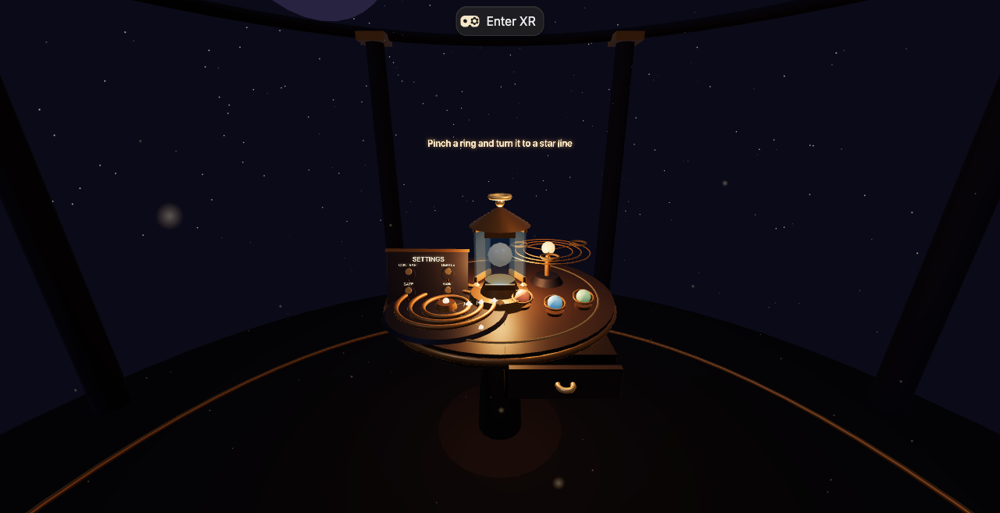

# The Lantern Room

**A seated, hands-first VR puzzle about waking a sleeping lantern.**

Meta VR Start Developer Competition 2026 entry · Track: **Gaming** · Division: **New Experience**



*The observatory table: constellation dial (front left), lantern (centre), orrery
(right), drawer (front), settings board (left). Screenshot from the real build
running in the IWSDK desktop view; see [Verification](#verification--honesty-notes).*

---

## Inspiration

The "Best First Five Minutes" brief asks for an opening that teaches itself. The
most memorable first five minutes in a headset are usually quiet ones: you look
at something small, reach for it, and it responds to your hand. So instead of a
menu, a tutorial, or a locomotion interlude, The Lantern Room gives you a warm
table in a dark observatory and three physical objects that are obviously
touchable. There is exactly one line of text. Everything else is taught by
reaction: hover glow, rotation, a satisfying click, a third of a lantern lighting
up.

The fantasy is simple: a lantern sits at the centre of an astronomer's table,
locked by three mechanisms. Each one is a small, quiet, hand-sized ritual.
Solving them wakes the lantern, and the room's fireflies come out to celebrate.

## What it does

A complete seated session is roughly **3–5 minutes** — the length of a bus stop.

| Mechanism | Hands-first interaction | What gives it away |
| --- | --- | --- |
| **Constellation dial** | Pinch one of three concentric rings and twist your wrist to rotate it. Each ring snaps when its rune notch lines up with an engraved star line. | Glowing rune markers and three engraved target lines inlaid in the table. |
| **Hidden drawer** | Pinch the brass drawer knob and pull toward yourself, then pinch the hidden bolt inside and slide it sideways. | The drawer only appears once you pull; the bolt glints when revealed. |
| **Orrery** | Pinch a small planet and place it into a matching orbit cradle. Correct placements lock in with a chime; wrong ones bounce home. | Three coloured planets, three empty orbit slots sized to match. |

Each solved mechanism lights one of the lantern's three base gems and one third
of its glow. When all three are done, the lantern's petals swing open, the cap
rises, a swarm of fireflies bursts out, and a soft finale plays. The lantern then
offers a **soft restart**: pinch it to begin again without leaving the session.

**Accessibility and comfort**

- **High-contrast palette** (settings board or `C` key) — darker room, brighter
  brass and runes, higher ambient separation.
- **Gentle motion** (settings board or `G` key) — removes flicker and most
  particle drift for comfort.
- **Gaze-dwell Assist** (settings board or `A` key) — look at a mechanism to
  advance it one small step per dwell. Every hand interaction has an eyes-only
  equivalent; it is deliberately slow so it assists rather than skips.
- **Controller support is optional** — the same near-grab gestures work with
  controller grips; no controller is needed at any point.
- **Seated by design** — no locomotion, no snap turns, everything within a
  ~2 ft reach bubble (the "airplane seat test").
- **Keyboard shortcuts** for desktop testing: `C` contrast, `G` gentle motion,
  `A` gaze assist, `R` restart.

No text walls: one hint line, and four small labels on the settings board.
Everything is in English, as required by the rules.

## How we built it

**Platform.** The project is a Vite + TypeScript app built with Meta's
[Immersive Web SDK (IWSDK)](https://iwsdk.dev), an ECS built on Three.js. IWSDK
gives us the WebXR session lifecycle, hand tracking, the grab system, the
renderer/player rig, and IWER — its browser XR emulator — so the same code runs
on Quest and can be tested on a desktop.

**Zero external assets.** All geometry is procedural Three.js primitives, all
materials are created in code, all lettering is rendered into an HTML canvas at
runtime, and every sound is synthesised with WebAudio. The build contains no
textures, models, fonts, or audio files, makes no runtime network requests, and
uses no CDNs. That keeps the bundle self-contained, licence-clean, and fast on
Quest.

**Architecture: a pure puzzle model with a thin 3D view.**

- `src/puzzle/state.ts` — a dependency-free state machine (`LanternPuzzle`) for
  all three mechanisms, progress, finale, reset and the accessibility assist
  steps. It has no DOM, Three.js or IWSDK imports, which is why it can be unit
  tested in plain Node.
- `src/scene/build.ts` — builds the observatory and returns typed handles
  (`RoomScene`) for every interactive object.
- `src/scene/room.ts` — the per-frame view: reads IWSDK's `Grabbed` ECS tag,
  mirrors hand-driven transforms into the state machine, animates the lantern,
  fireflies, dust and hint card, synthesises audio cues, and runs the gaze assist.
- `src/systems/lantern-room-system.ts` — a tiny IWSDK system that ticks the room
  with the engine's player/input context.

**Hand interactions with the built-in grab system.** Rather than reimplement
pointer handling, each mechanism is an IWSDK entity with `OneHandGrabbable`.
The grab system's constraints do the physical work: the dial rings are
rotation-only around Y, the drawer slides only on Z (absolute position box in the
table's local space), the bolt slides only on X inside the drawer, and planets
move inside a bounded 3D box. Room code then watches the ECS `Grabbed` tag to
apply game rules (snap, lock, reject, celebrate). Because the grab system forwards
hand pinches into the same pointer pipeline as controllers, hands are the primary
input and controllers work for free.

**Audio.** `src/lib/audio.ts` is a small WebAudio synthesiser: sine-partial bells,
filtered noise bursts, a low drone pad that swells with puzzle progress, stereo
panning and distance attenuation relative to the player's head. No samples.

**Testing and tooling.**

- 29 Vitest unit tests cover the puzzle rules: angle wrapping, dial tolerance and
  snapping, drawer/bolt thresholds, wrong-slot rejection, progress counting,
  lantern opening, reset, and the assist path (`npm test`).
- `tsc --noEmit` typechecks the whole project (`npm run typecheck`).
- `scripts/dev.mjs` is a small dev launcher that degrades gracefully in
  restricted sandboxes where the OS blocks process inspection (see Challenges).
- `scripts/capture.mjs` captures screenshots (and XR-session evidence) through
  headless Chrome and the DevTools protocol — no extra npm dependencies. The
  screenshots in this README come from that script running against the real
  production build.

## Challenges

**Learning IWSDK from the source, not from assumptions.** Some IWSDK APIs are
newer than the public examples, and a few behaviours are subtle. Two examples we
had to verify in the installed package rather than guess:

- `OneHandGrabbable` constraints (`rotateMin/Max`, `translateMin/Max`) are
  **absolute values in the target's parent space**, not deltas from the object's
  current position. A naive `translateMin: [0,0,0]` on a drawer would teleport it
  to the room origin on first grab. The constraints in `build.ts` are written as
  absolute boxes with comments explaining this.
- The dial rings read their angle back from the rotated object each frame while
  grabbed, because the grab system owns the transform. Snapping happens on
  release, which is what makes the mechanism feel like a physical dial detent.

**Restricted build environment.** The development sandbox blocks writes to
`~/.npm` (so the npm cache lives in `.npm-cache/`), blocks `ps` (which IWSDK's dev
plugin uses to establish a runtime-owner identity), and cannot download a
Playwright browser. `scripts/dev.mjs` detects the blocked `ps` and provides a
dev-only shim so `npm run dev` still starts; headless screenshots use the
system-installed Chrome via DevTools Protocol instead of Playwright.

**No headset in the build environment.** We could not test on a Meta Quest. All
verification is emulator/browser-level and is marked honestly below; the user
must do the on-device pass before recording the video.

**Keeping the scene cheap.** 60 fps on Quest is a judging criterion, so the room
avoids post-processing and per-frame allocation, reuses a small number of
materials, and animates particles by writing into a single preallocated
`Float32Array`.

## Accomplishments

- A complete, start-to-finish hands-first experience with three distinct
  interactions, a progression, a finale and a soft reset — in a static WebXR
  build that installs with one `npm install`.
- A fully procedural art direction: warm/cool observatory lighting, star dome,
  dust motes, constellation inlay, and a firefly finale, with no external assets.
- A clean separation between a tested pure state machine and the 3D view.
- Accessibility designed in rather than bolted on: high-contrast palette, gentle
  motion, gaze-dwell assist for every mechanism, and keyboard equivalents.
- Real verification of the build: typecheck, 29 unit tests, production build, a
  served preview, and screenshots captured from the built app.

## What we learned

- **The grab system is the product.** IWSDK's near-grab handles give you
  believable physical manipulation for free; the design work is in the
  constraints and the feedback (snap windows, chimes, light).
- **Affordance beats onboarding.** The fastest way to teach a mechanism was to
  make the target visible (star lines, empty cradles, a glinting bolt) instead of
  writing instructions.
- **A tested puzzle model is a design tool.** Being able to solve the whole
  experience in unit tests (including the eyes-only assist path) caught logic
  problems before they could become headset debugging sessions.
- **Verify APIs in the installed package.** Documentation lags implementation in
  fast-moving XR SDKs; reading the shipped types and source saved us from
  guesswork.
- **Restricted environments punish assumed tooling.** Cache paths, process
  inspection and browser downloads all needed fallbacks so the project would
  build and run anywhere.

## What's next

**Target launch date: Friday, 2027-02-19** on the Meta Horizon Store (as a
Quest app submission; the same WebXR build can also ship as a hosted app).

Planned improvements, in order:

1. **On-device hand-tuning.** Tune pinch grab radii, snap windows and dial
   sensitivity against real Quest hand-tracking data, and measure frame time to
   confirm a stable 60 fps.
2. **More rooms, one lantern.** A short "night watch" progression: three small
   observatory tables with different mechanism sets, with the lantern carrying
   light between them.
3. **Deeper accessibility pass.** Voice-over narration for the hint line, a
   one-switch mode, and colour-blind-safe planet markings (shape as well as hue).
4. **Passthrough mode.** An optional mixed-reality variant that anchors the
   observatory table to the player's real table using scene understanding.
5. **Sound polish.** A richer spatial pad and hand-tracking-driven contact
   sounds (pinch ticks, drawer rollers).

## Built with

- [Meta Immersive Web SDK (IWSDK)](https://iwsdk.dev) `@iwsdk/core` — ECS, WebXR,
  hand tracking, grab system, IWER emulator (`@iwsdk/vite-plugin-dev`)
- [Three.js](https://threejs.org) (via the SDK's `super-three` alias)
- TypeScript, Vite, Vitest
- WebAudio + Canvas 2D (procedural audio and lettering, no assets)
- `@pmndrs/handle` / `@pmndrs/pointer-events` (used through IWSDK's grab system)

No 3D models, images, fonts, audio files, or third-party services were used.

## Quickstart

Requirements: Node.js 20.19+ or 22.12+ (developed on Node 22), npm.

```bash
npm install
npm run dev        # https://localhost:5173 — IWSDK injects IWER on localhost
```

Open the printed URL in desktop Chrome. Click **Enter XR** to enter the emulated
Quest session (IWER). On a headset on the same network, open the printed network
URL; Quest Browser uses native WebXR and skips the emulator.

```bash
npm test           # Vitest: 29 unit tests for the puzzle state machine
npm run typecheck  # tsc --noEmit
npm run build      # static production build in dist/
npm run preview    # serve dist/ at https://localhost:4173
```

> **Sandbox note.** npm needs a writable cache in some environments:
> `npm_config_cache=$PWD/.npm-cache npm install`. `npm run dev` uses
> `scripts/dev.mjs`, which adds a local `ps` shim only if the OS blocks `ps`
> (IWSDK's dev plugin uses it for its dev-server lock); on a normal machine it
> simply starts Vite.

### Mock / emulator / Quest notes

- **Desktop (no headset):** `npm run dev` or the hosted link → **Enter XR** →
  IWER emulates a Quest 3 with controllers and hand-tracking support. The
  production build also injects IWER on desktop browsers (Quest Browser is
  excluded by user-agent), so judges can test the hosted link without a headset.
- **Quest:** open the hosted link in Meta Quest Browser and press **Enter VR**;
  put the controllers down to use hand tracking, or use controller grips.
- **Flat desktop view:** without entering XR you get a passive 3D view of the
  room — useful for screenshots, but the puzzle needs hands (Enter XR).

## Project structure

```text
contest-entries/meta-vr/
├── index.html                     # app shell + boot fallback
├── iwsdk.config.json              # IWSDK project authority (scene, XR, IWER)
├── public/scenes/main.iwsdk.scene.json  # night-sky level environment
├── src/
│   ├── index.ts                   # World.create + system registration
│   ├── puzzle/state.ts            # pure puzzle state machine (tested)
│   ├── scene/build.ts             # procedural observatory + interactables
│   ├── scene/room.ts              # per-frame room logic, audio, finale, assist
│   ├── scene/theme.ts             # comfort / high-contrast palettes
│   ├── systems/lantern-room-system.ts
│   ├── lib/audio.ts               # WebAudio synthesiser
│   └── lib/canvas-text.ts         # canvas-texture lettering / sprites
├── tests/puzzle-state.test.ts     # 29 Vitest unit tests
├── scripts/dev.mjs                # dev launcher (sandbox-safe)
├── scripts/capture.mjs            # headless-Chrome screenshots (dev only)
├── screenshots/                   # captures from the built app
├── README.md · SUBMISSION.md · RULES-NOTES.md · DEPLOY.md · LICENSE
```

## Verification & honesty notes

What was actually run and observed in the build environment (2026-10-27):

| Check | Result |
| --- | --- |
| `npm test` (Vitest) | **29 tests passed** |
| `npm run typecheck` (`tsc --noEmit`) | **passes** |
| `npm run build` (`vite build`) | **succeeds**, static `dist/` produced |
| `npm run dev` | **starts** (Vite + IWSDK dev server, HTTPS on port 5173) and serves the app |
| Production bundle served with `vite preview` | page boots; `window.__lanternRoom` reports the room ready; IWER **Enter XR** works |
| Headless Chrome screenshots (real build) | 4 captured: desktop view, high-contrast mode, lantern finale, IWER XR session |
| XR session in IWER emulator | entered successfully; controller/hand emulation panels render around the scene |
| Audio | synthesised in-browser; no audio files. Autoplay/gesture behaviour on Quest **not verified** |
| **On-device Quest testing** | **UNVERIFIED — no headset in the build environment** |
| Pinch-grab feel, snap windows, dial sensitivity on real hand tracking | **UNVERIFIED** |
| Sustained 60 fps on Quest hardware | **UNVERIFIED** (scene is deliberately light, but not measured on device) |

The screenshots are genuine captures of the built app via the DevTools protocol;
the XR screenshot shows the IWER emulated session looking forward (the table
sits below the emulator's default standing eye height — a seated player looks
down at it naturally). Nothing in this repository claims Quest testing.

## Deployment

See [`DEPLOY.md`](DEPLOY.md) for exact GitHub Pages steps (including the
included workflow). Short version: build with `npm run build`, publish `dist/`,
enable Pages with HTTPS.

## Licence

MIT — see [`LICENSE`](LICENSE). Third-party licences are listed there. IWSDK,
Three.js and the rest of the toolchain are open source; no assets from
unlicensed repositories were used.
